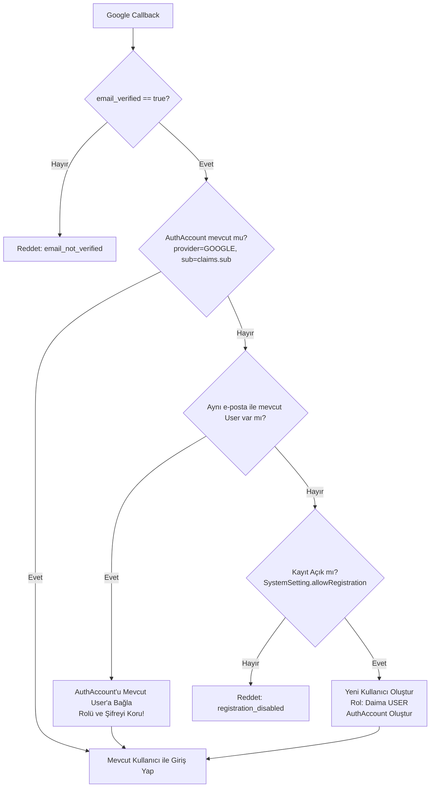

# Google Sign-In & Account Linking (OAuth 2.0 / OIDC)

Bu doküman, `game-deals` sistemine eklenen Google ile Giriş ve Hesap Eşleme (Account Linking) mimarisini, güvenlik kontrollerini ve yapılandırma gereksinimlerini açıklar.

---

## 1. Genel Bakış

Sistemde iki giriş yöntemi desteklenmektedir:
1. **E-posta + Şifre (Yerel Kimlik Doğrulama)**
2. **Google ile Giriş (OpenID Connect / OAuth 2.0 Authorization Code Flow)**

Mevcut özel JWT oturum sistemi (`game_deals_session` çerezi) aynen korunmuştur. Google yalnızca bir harici kimlik sağlayıcı (Identity Provider) olarak çalışır; Google erişim belirteci doğrudan uygulama oturumu olarak kullanılmaz. Google doğrulaması tamamlandıktan sonra standart uygulama oturum çerezi üretilir.

---

## 2. Gerekli Ortam Değişkenleri (Environment Variables)

| Değişken | Açıklama | Örnek / Varsayılan |
| :--- | :--- | :--- |
| `GOOGLE_CLIENT_ID` | Google Cloud Console'dan alınan OAuth 2.0 İstemci Kimliği | `123456789-xxx.apps.googleusercontent.com` |
| `GOOGLE_CLIENT_SECRET` | Google Cloud Console'dan alınan İstemci Gizli Anahtarı (**Gizli tutulmalıdır**) | `GOCSPX-xxxxxxxxxxxxxxxx` |
| `APP_URL` | Uygulama ana adresi (Callback URI üretiminde kullanılır) | `https://game.alperates.com.tr` / `http://localhost:3000` |
| `SESSION_SECRET` | Oturum ve OAuth state çerezlerinin imzalanması için en az 64 karakterli anahtar | Mevcut güçlü anahtar |

> [!CAUTION]
> `GOOGLE_CLIENT_SECRET` değeri sunucu tarafında kalmalıdır. Asla `NEXT_PUBLIC_` ön eki ile istemciye sızdırılmamalı, loglara yazdırılmamalı veya arayüzde gösterilmemelidir.

---

## 3. Yetkili URL'ler (Authorized URLs)

### Authorized JavaScript Origins
- **Production:** `https://game.alperates.com.tr`
- **Yerel Geliştirme:** `http://localhost:3000`

### Authorized Redirect URIs (OAuth Callback)
- **Production Callback URL:**
  `https://game.alperates.com.tr/api/auth/google/callback`
- **Yerel Callback URL:**
  `http://localhost:3000/api/auth/google/callback`

---

## 4. Veri Modeli ve Veritabanı Yapısı

Google kimlik bilgileri `User` tablosuna düzensiz alanlar eklemek yerine bağımsız bir `AuthAccount` tablosunda saklanır:

```prisma
enum AuthProvider {
  GOOGLE
}

model AuthAccount {
  id                String       @id @default(cuid())
  userId            String
  user              User         @relation(fields: [userId], references: [id], onDelete: Cascade)
  provider          AuthProvider
  providerAccountId String       // Google immutable 'sub' claim
  createdAt         DateTime     @default(now())
  updatedAt         DateTime     @updatedAt

  @@unique([provider, providerAccountId])
  @@index([userId])
}
```

### `User.passwordHash` Nullable Yapısı
- `User.passwordHash` alanı `String?` olarak güncellenmiştir.
- Yalnızca Google ile kayıt olan kullanıcıların yerel şifre belirleme zorunluluğu yoktur.
- Mevcut yerel kullanıcıların hash'leri ve şifreli girişleri aynen korunmaktadır.
- Şifresi olmayan kullanıcılar yerel `/api/auth/login` endpoint'ine şifre ile istek atarsa sistem güvenli bir şekilde Google ile giriş yapmaları gerektiğini bildirir.

---

## 5. Hesap Eşleme (Account Resolution & Linking) Akışı

Google OAuth geri çağrısı (`/api/auth/google/callback`) sonrasında aşağıdaki sıra katı şekilde işletilir:



### Kritik Kurallar:
1. **Mevcut OWNER Korunması:** Eğer `owner@alperates.com.tr` e-postasına sahip sistem yöneticisi Google ile giriş yaparsa, yeni kullanıcı oluşturulmaz. Google kimliği mevcut hesaba bağlanır ve `role: OWNER` yetkisi kesinlikle korunur (`USER` rolüyle ezilmez).
2. **Google Kaydı Daima USER:** Google üzerinden yeni hesap oluşturulduğunda rol her zaman `USER` olarak atanır. Sistemde hiç kullanıcı olmasa dahi Google üzerinden otomatik OWNER üretilmez.
3. **Kayıt Politikası Tutarlılığı:** `SystemSetting.allowRegistration` anahtarı kapalıysa yeni Google hesabı açılamaz. Ancak önceden kayıtlı kullanıcılar Google ile giriş yapmaya veya hesaplarını bağlamaya devam edebilirler.

---

## 6. Güvenlik Modeli

1. **RFC-Uyumlu PKCE (Proof Key for Code Exchange):**
   - Her yetkilendirme isteğinde kriptografik `code_verifier` (S256) ve `code_challenge` üretilir.
2. **Kriptografik State ve Nonce:**
   - CSRF saldırılarına karşı rastgele `state` ve `nonce` değerleri üretilir.
3. **Geçici Güvenli Çerez (`game_deals_oauth_state`):**
   - State, code_verifier ve returnTo parametreleri sunucu tarafında `SESSION_SECRET` ile HS256 JWT formatında imzalanarak 10 dakika geçerli, `httpOnly: true`, `sameSite: "lax"`, `secure` (prod) çerezde saklanır. Sunucu belleği (in-memory) tutulmaz; yatay ölçeklenebilir ve güvenlidir.
4. **ID Token ve İmza Doğrulaması:**
   - Google'ın canlı JWKS sertifikaları (`https://www.googleapis.com/oauth2/v3/certs`) üzerinden ID token imzası, issuer (`https://accounts.google.com`), audience (`GOOGLE_CLIENT_ID`) ve geçerlilik süresi standartlara tam uyumlu `openid-client` kütüphanesi ile doğrulanır.
5. **E-posta Doğrulama Zorunluluğu:**
   - Google ID token'ındaki `email_verified` alanı kesinlikle `true` olmalıdır. Doğrulanmamış hesaplar reddedilir.
6. **Açık Yönlendirme (Open Redirect) Koruması:**
   - Giriş sonrası yönlendirme adresi (`returnTo`) kesinlikle filtrelenir; yalnızca `/` ile başlayan göreli dahili yollara izin verilir. Protokol içeren harici adresler `/profil` yoluna düşürülür.
7. **Eşzamanlı İstek (Concurrency / Race-Condition) Güvenliği:**
   - Aynı Google hesabı için eşzamanlı iki geri çağrı gelmesi durumunda veritabanı benzersiz kısıtı (`provider_providerAccountId_key`) ve transaction düzeyinde kilit mekanizması duplicate hesap veya kullanıcı oluşmasını engeller.

---

## 7. Kullanıcı Arayüzü (UI) ve Durum Gösterimi

- **Giriş ve Kayıt Ekranları (`/login`, `/register`):**
  - Resmi Google marka kurallarına uygun 4 renkli Google logosu ve responsive "Google ile Devam Et" butonu eklenmiştir.
  - Eğer `GOOGLE_CLIENT_ID` ve `GOOGLE_CLIENT_SECRET` ortam değişkenleri tanımlı değilse buton arayüzde gizlenir veya bozuk tıklama üretilmez.
- **Profil Ekranı (`/profil`):**
  - Kullanıcının hesabına bağlı giriş yöntemleri read-only olarak gösterilir (✓ Şifre, ✓ Google).
  - Google avatarı mevcutsa kullanıcının profil resmi olarak görüntülenir.
- **Yönetici Ayarları (`/ayarlar`):**
  - Genel Ayarlar sekmesinde Google Sign-In durumu `CONFIGURED (Aktif)` veya `NOT_CONFIGURED (Yapılandırılmadı)` şeklinde secret sızdırılmadan gösterilir.
