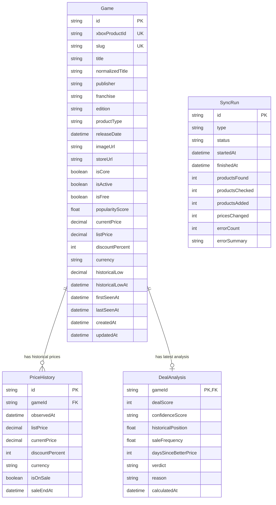

# VERİ TABANI MODELİ (DATABASE MODEL SPECIFICATION)

**Proje:** Xbox Gerçek Fırsat Takip Sistemi (`game.alperates.com.tr`)  
**ORM:** Prisma ORM  
**Veritabanı:** PostgreSQL  

---

## 1. Varlık İlişki Diyagramı (ERD)



---

## 2. Prisma Şema Tanımı (Prisma Schema Reference)

```prisma
datasource db {
  provider = "postgresql"
  url      = env("DATABASE_URL")
}

generator client {
  provider = "prisma-client-js"
}

enum SyncType {
  PRICE_SYNC
  CORE_SYNC
  DISCOVERY
}

enum SyncStatus {
  RUNNING
  COMPLETED
  PARTIAL
  FAILED
}

enum ConfidenceLevel {
  LOW
  MEDIUM
  HIGH
  VERY_HIGH
}

enum DealVerdict {
  EXCELLENT   // 🔥 Kaçırma (90-100)
  VERY_GOOD   // 🟢 Çok İyi (80-89)
  GOOD        // 🟡 İyi (65-79)
  WAIT        // 🟠 Bekle (45-64)
  POOR        // 🔴 Zayıf Fırsat (0-44)
}

model Game {
  id                String       @id @default(cuid())
  xboxProductId     String       @unique
  slug              String       @unique
  title             String
  normalizedTitle   String
  publisher         String?
  franchise         String?
  edition           String?
  productType       String       @default("Game")
  releaseDate       DateTime?
  imageUrl          String?
  storeUrl          String
  isCore            Boolean      @default(false)
  isActive          Boolean      @default(true)
  isFree            Boolean      @default(false)
  popularityScore   Float        @default(0)

  // Current pricing snapshot
  currentPrice      Decimal      @db.Decimal(10, 2)
  listPrice         Decimal      @db.Decimal(10, 2)
  discountPercent   Int          @default(0)
  currency          String       @default("TRY")

  // Observed historical low
  historicalLow     Decimal      @db.Decimal(10, 2)
  historicalLowAt   DateTime     @default(now())

  firstSeenAt       DateTime     @default(now())
  lastSeenAt        DateTime     @default(now())
  createdAt         DateTime     @default(now())
  updatedAt         DateTime     @updatedAt

  priceHistories    PriceHistory[]
  dealAnalysis      DealAnalysis?

  @@index([isCore, isActive])
  @@index([discountPercent(sort: Desc)])
  @@index([historicalLow])
}

model PriceHistory {
  id              String       @id @default(cuid())
  gameId          String
  game            Game         @relation(fields: [gameId], references: [id], onDelete: Cascade)
  observedAt      DateTime     @default(now())
  listPrice       Decimal      @db.Decimal(10, 2)
  currentPrice    Decimal      @db.Decimal(10, 2)
  discountPercent Int          @default(0)
  currency        String       @default("TRY")
  isOnSale        Boolean      @default(false)
  saleEndAt       DateTime?

  @@index([gameId, observedAt(sort: Desc)])
  @@index([gameId, currentPrice(sort: Asc)])
}

model DealAnalysis {
  gameId                String          @id
  game                  Game            @relation(fields: [gameId], references: [id], onDelete: Cascade)
  dealScore             Int             // 0-100
  confidenceScore       ConfidenceLevel @default(LOW)
  historicalPosition    Float           // 0.0 - 1.0 (0: at low, 1: at high)
  saleFrequency         Float           @default(0)
  daysSinceBetterPrice  Int?
  verdict               DealVerdict     @default(WAIT)
  reason                String          // Türkçe gerekçe
  calculatedAt          DateTime        @default(now())
}

model SyncRun {
  id              String       @id @default(cuid())
  type            SyncType
  status          SyncStatus   @default(RUNNING)
  startedAt       DateTime     @default(now())
  finishedAt      DateTime?
  productsFound   Int          @default(0)
  productsChecked Int          @default(0)
  productsAdded   Int          @default(0)
  pricesChanged   Int          @default(0)
  errorCount      Int          @default(0)
  errorSummary    String?
}
```

---

## 3. Fiyat Geçmişi Değişim Tespiti (Price Change Invariant)

Fiyat geçmişi tablosuna (`PriceHistory`) her senkronizasyonda körlemesine satır eklenmez:
1. Oyunun son kayıtlı `currentPrice` ve `listPrice` değerleri yeni gelen normalize değerlerle karşılaştırılır.
2. Ondalık (Decimal) seviyesinde fark tespit edilirse (`!currentPrice.equals(newPrice) || !listPrice.equals(newListPrice)`):
   - Yeni `PriceHistory` satırı eklenir.
   - `Game.currentPrice`, `Game.listPrice`, `Game.discountPercent`, `Game.lastSeenAt` güncellenir.
   - Yeni fiyat `historicalLow` değerinden küçükse `historicalLow` ve `historicalLowAt` güncellenir.
   - `DealAnalysis` yeniden hesaplanır.
3. Fiyat aynı ise:
   - Sadece `Game.lastSeenAt` güncellenir.
   - Yeni `PriceHistory` açılmaz (idempotent koruma).
